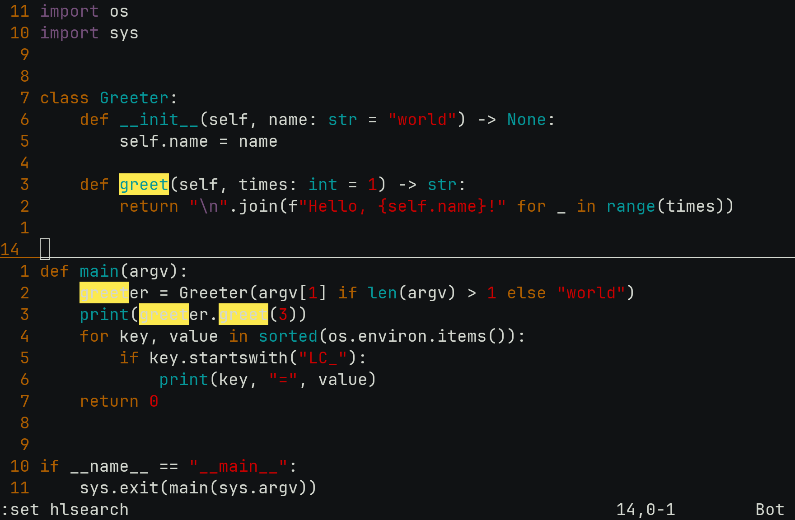
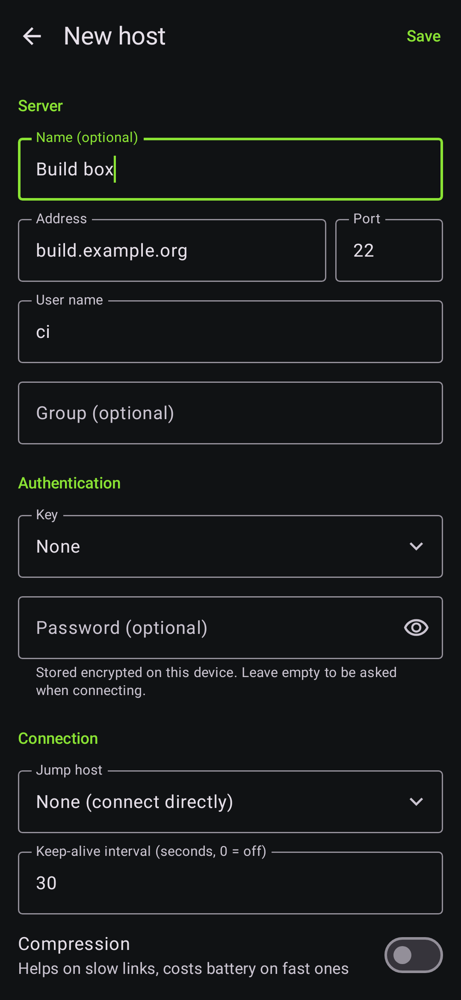

# Shh

An open-source SSH client for Android: a real terminal, saved hosts, keys, port forwarding and
file transfer, with no ads, accounts or tracking.

| Hosts | Terminal | Host settings | Settings |
|---|---|---|---|
|  |  |  |  |

The terminal picture is not a mock-up: it is the app's own drawing code replaying the recorded
output of `vim`, produced by the test suite.

## Features

**Terminal**

- xterm-256color compatible emulator written from scratch in Kotlin: 256 and 24-bit colour,
  bold/faint/italic/underline/strikethrough, alternate screen, scroll regions, line drawing,
  double-width and combining characters, bracketed paste, mouse reporting, focus events, window
  title, OSC colour queries.
- Scrollback with text re-wrapped when the screen size changes.
- Several sessions at once in tabs; they stay connected in the background.
- A bar with the keys a phone keyboard lacks: Esc, Tab, Ctrl and Alt (tap twice to lock), arrows
  that repeat while held, Home/End and Page Up/Down, plus a panel with F1–F12 and the characters
  a shell needs but a phone hides, such as `~ \ { } [ ]`.
- The bar is yours to arrange: choose which key sits where, including keys that type a few
  characters of your own, and let it step aside while a hardware keyboard is connected.
- Hardware keyboard support, pinch to zoom, long-press to select and copy or to open a web
  address, Ctrl+Shift+C / Ctrl+Shift+V.
- Keyboards are asked for plain characters by default (no autocorrect); a setting turns on
  voice typing, swipe typing and composing keyboards such as Chinese, Japanese and Korean.
- Twelve colour schemes (green on black, Dracula, Solarized, Gruvbox, Nord, One Dark, Tokyo Night, …),
  per host if you like. JetBrains Mono is bundled, and any monospaced `.ttf` or `.otf` file can
  take its place.
- Scrolling inside `less`, `man` or `vim` works with a swipe.

**Connections**

- Password, public key and keyboard-interactive login, including multi-factor (key + one-time
  code).
- Jump hosts (like `ssh -J`), chained as deep as you need.
- Agent forwarding (`ssh -A`): programs on a server can use the keys stored in the app, and the
  app asks before a key is used.
- Login with a key on a FIDO2 security key (OpenSSH's `sk-ssh-ed25519` and `sk-ecdsa` keys):
  hold the key against the phone (NFC) or plug it in (USB), with its PIN where the key or the
  server asks for it. See [Security keys](#security-keys) for what has and has not been tested.
- A host name with several addresses is tried address by address, so a broken IPv6 route does
  not stop the connection; IPv4 or IPv6 can be forced per host.
- Local (`-L`), remote (`-R`) and dynamic SOCKS (`-D`) port forwarding, configured per host or
  added to a running session.
- Host keys are verified on first use and remembered; a changed key is reported loudly.
- Modern algorithms only by default (Curve25519, ChaCha20-Poly1305, AES-GCM, Ed25519,
  rsa-sha2). Legacy algorithms for old devices can be enabled per host.
- Keep-alive, optional compression, a command to run after login (for example
  `tmux new -A -s main`).
- A connection that drops, for example when the phone changes networks, is re-established
  automatically, with its port forwards and the command after login.
- Mosh, for hosts that have it installed: the session logs in over SSH, then carries on over
  UDP and survives changes of network and long silences without logging in again. Where Mosh
  cannot be started or UDP does not get through, the session simply stays on SSH. See
  [Mosh](#mosh).
- Home screen shortcuts to the hosts used last, and `ssh://` links (the address is filled in;
  you decide whether to connect).
- A notification when a session in the background rings the bell, for example at the end of a
  long command.
- Quick connect: type `user@host:port` and go.
- Import of an OpenSSH client configuration (`~/.ssh/config`): its hosts with their addresses,
  users, jump hosts (`ProxyJump`, or `ProxyCommand ssh -W`), port forwards and the other
  settings the app has a counterpart for. The file is read the way `ssh` reads it, which the
  tests check against `ssh -G`.

**Keys**

- Generate Ed25519, ECDSA and RSA keys on the device.
- Import OpenSSH, PEM, PKCS#8 and PuTTY keys, with or without a passphrase.
- Export in OpenSSH format with an optional passphrase; share the public key.
- Install a public key on the server you are connected to (what `ssh-copy-id` does).
- OpenSSH certificates: add the certificate an authority issued for a key and servers that
  trust the authority accept it (Ed25519 and ECDSA keys).
- Keys on a security key: make a new one on the hardware from the app, or import the key file
  `ssh-keygen -t ed25519-sk` wrote on a computer.

**Files**

- SFTP browser: upload, download, rename, delete, change permissions, create folders, and edit
  small text files in place.

**Everything else**

- Snippets: saved commands you can send to a terminal.
- Passwords and private keys are encrypted with a key held in the Android Keystore.
- Encrypted backup and restore of all hosts, keys and settings, protected by a passphrase. (A
  font file of your own is not part of the backup; choose it again after restoring.)
- Optional app lock using the system fingerprint/face/screen-lock prompt.
- Material 3 design with light, dark and wallpaper-based colours.
- A built-in how-to that explains the key bar, the touch gestures and where things are.

## Requirements

Android 8.0 (API 26) or later. On Android 17 and later the app asks for the "Nearby devices"
permission the first time you connect: the system requires it for reaching servers on your local
network. Without it Android silently drops those connections, so they time out; the app says so
when that happens and offers to ask again.

## Building

You need JDK 21 (what the project is built and tested with) and the Android SDK (platform 37.2,
build tools 36.0.0). Point `ANDROID_HOME` at the SDK or create a `local.properties` with
`sdk.dir=…`.

```sh
./gradlew :app:assembleDebug        # app/build/outputs/apk/debug/app-debug.apk
./gradlew :app:assembleRelease      # minified, unsigned
```

## Project layout

| Module | What it is |
|---|---|
| `terminal-core` | The terminal emulator. Pure Kotlin, no Android dependencies. |
| `ssh-core` | Connections, authentication, port forwarding, SFTP and key handling on top of [sshj](https://github.com/hierynomus/sshj). Pure Kotlin. |
| `mosh-core` | A client for the Mosh protocol, written for this app. Pure Kotlin. |
| `app` | The Android application: Jetpack Compose UI, storage, the terminal view and the foreground service that keeps sessions alive. |

Keeping the cores free of Android makes them testable on any machine with a JDK.

## Testing

```sh
./gradlew test
```

runs everything that needs no device:

- **Terminal emulator** – unit tests for the escape sequences, plus differential tests that
  replay the recorded output of real programs (vim, less, nano, htop, top, bash, tmux, a curses
  program) and require the same screen and cursor position that tmux ends up with. The
  recordings are made with `tools/record_fixtures.py`.
- **SSH** – end-to-end tests against an SSH server running inside the test JVM (Apache MINA),
  key file tests against the real `ssh-keygen` and configuration file tests against the real
  `ssh` when they are installed.
- **Mosh** – unit tests of the wire format and the state synchronisation, and tests against a
  real `mosh-server` when one is installed (`apt install mosh`), also over a simulated network
  that loses, delays and reorders datagrams.
- **App** – storage and backup tests, Compose UI tests, and tests that draw real program output
  through the terminal view. Screenshots are written to `app/build/outputs/screenshots`.

Some tests talk to a real OpenSSH server and are skipped unless one is configured:

```sh
sudo tools/test-sshd.sh start     # prints an "export SHH_TEST_OPENSSH=…" line; run it
./gradlew test
sudo tools/test-sshd.sh stop
```

Tests that need a device or emulator (cryptography provider, Android Keystore, foreground
service, SSH running on Android itself):

```sh
./gradlew :app:connectedDebugAndroidTest \
    -Pandroid.testInstrumentationRunnerArguments.sshHost=10.0.2.2 \
    -Pandroid.testInstrumentationRunnerArguments.sshPort=2222 \
    -Pandroid.testInstrumentationRunnerArguments.sshUser=shhtest \
    -Pandroid.testInstrumentationRunnerArguments.sshPassword=shh-Test-pw-1 \
    -Pandroid.testInstrumentationRunnerArguments.authorizedKeys=/tmp/shh-test-sshd/authorized_keys
```

(`10.0.2.2` is how an emulator reaches the machine it runs on.)

## Security notes

- Secrets never leave the device except in a backup you create yourself, and that is encrypted
  with your passphrase (PBKDF2-HMAC-SHA256, AES-256-GCM).
- The app declares no analytics, no crash reporting and no network access other than the SSH
  connections you make.
- Programs on a server can ask the terminal to put text on the clipboard (OSC 52). This is off
  by default, and reading the clipboard is never allowed.
- Pasted text is stripped of escape characters so that it cannot smuggle in control sequences.

Please report security problems privately to the maintainers rather than in a public issue.

## Security keys

A key that lives on a FIDO2 security key (a YubiKey, Nitrokey, SoloKey and the like) cannot be
copied off the phone, because it is not on the phone: the app holds the public key and a
handle, and every login needs the hardware to sign, with a touch and, if you choose so, its PIN.

What is tested, and how:

- The SSH side against a real OpenSSH server: both key types log in, and the server refuses a
  signature that lacks the touch or the PIN check it demands. Key files are read and written
  in agreement with `ssh-keygen`.
- The conversation with the security key (CTAP2, through the
  [Yubico SDK](https://github.com/Yubico/yubikit-android)) against an authenticator made of
  software that is part of the tests: signing, making keys, both ways of proving the PIN,
  wrong PINs, the wrong key, a key that is not touched.

What is **not** tested: real hardware over real NFC or USB. No security key was available
while this was written, so treat the feature as experimental until it has worked with yours,
and please report how it went. Keys that only speak the older U2F protocol are not supported.

## Mosh

Switch on "Use Mosh" in a host's settings. The host needs `mosh-server` installed (the `mosh`
package of most systems) and has to be reachable over UDP on ports 60001 to 60999.

The Mosh client in this app is its own implementation of the protocol, not the reference
client: Mosh is licensed under the GPL and this app is not. It was written from scratch; how
the protocol looks on the wire was learned from the Mosh paper and from reading the Mosh
sources, without copying code. It talks to a stock `mosh-server` and is tested against
version 1.4. What differs from the `mosh` you may know:

- No local echo. What you type shows when the server's answer arrives, as with SSH.
- Output that scrolls quickly is shown in fewer steps than the reference client shows on a
  slow connection. The screen is always right in the end.
- Little scrollback: Mosh transmits the screen, not everything that was printed. That is true
  of every Mosh client.
- A Mosh session has no SSH connection, so no file browser, no port forwards and no forwarded
  agent. Hosts behind a jump host work only if their UDP ports can be reached directly.
- It keeps talking to the server every few seconds, which uses more battery than an idle SSH
  session.
- A server whose app does not come back ends itself after a week.

Not tested: IPv6, servers other than 1.4, and real changes of network on a real phone (the
tests move the session to a new socket on the same machine).

## Not there yet

- X11 forwarding.
- Certificates for RSA keys: the SSH library can only sign those the old SHA-1 way, which
  current servers refuse.
- Translations: the interface is English only for now.
- The app has not been published to an app store.

## Licence

Apache License 2.0, see [LICENSE](LICENSE). Third-party components are listed in
[NOTICE](NOTICE).
