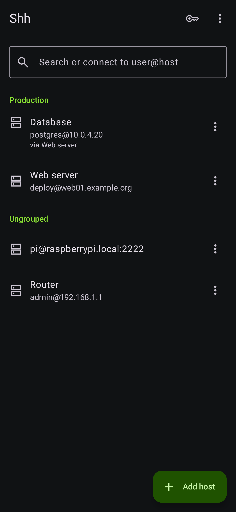
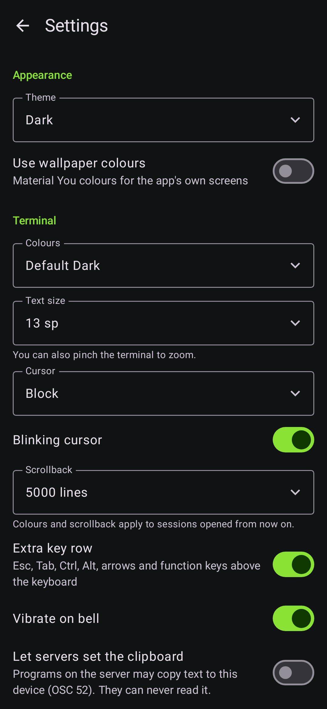

# Shh

An open-source SSH client for Android: a real terminal, saved hosts, keys, port forwarding and
file transfer, with no ads, accounts or tracking.

| Hosts | Terminal | Host settings | Settings |
|---|---|---|---|
|  |  |  |  |

The terminal picture is not a mock-up: it is the app's own drawing code replaying the recorded
output of `vim`, produced by the test suite.

## Features

**Terminal**

- xterm-256color compatible emulator written from scratch in Kotlin: 256 and 24-bit colour,
  bold/faint/italic/underline/strikethrough, alternate screen, scroll regions, line drawing,
  double-width and combining characters, bracketed paste, mouse reporting, focus events, window
  title, OSC colour queries.
- Scrollback with text re-wrapped when the screen size changes.
- Several sessions at once in tabs; they stay connected in the background.
- Extra key row (Esc, Tab, Ctrl, Alt, arrows, Home/End, Page Up/Down, F1–F12), hardware keyboard
  support, pinch to zoom, long-press to select and copy, Ctrl+Shift+C / Ctrl+Shift+V.
- Eleven colour schemes (Dracula, Solarized, Gruvbox, Nord, One Dark, Tokyo Night, Monokai, …),
  per host if you like. JetBrains Mono is bundled.
- Scrolling inside `less`, `man` or `vim` works with a swipe.

**Connections**

- Password, public key and keyboard-interactive login, including multi-factor (key + one-time
  code).
- Jump hosts (like `ssh -J`), chained as deep as you need.
- Local (`-L`), remote (`-R`) and dynamic SOCKS (`-D`) port forwarding, configured per host or
  added to a running session.
- Host keys are verified on first use and remembered; a changed key is reported loudly.
- Modern algorithms only by default (Curve25519, ChaCha20-Poly1305, AES-GCM, Ed25519,
  rsa-sha2). Legacy algorithms for old devices can be enabled per host.
- Keep-alive, optional compression, a command to run after login (for example
  `tmux new -A -s main`).
- Quick connect: type `user@host:port` and go.

**Keys**

- Generate Ed25519, ECDSA and RSA keys on the device.
- Import OpenSSH, PEM, PKCS#8 and PuTTY keys, with or without a passphrase.
- Export in OpenSSH format with an optional passphrase; share the public key.
- Install a public key on the server you are connected to (what `ssh-copy-id` does).

**Files**

- SFTP browser: upload, download, rename, delete, change permissions, create folders, and edit
  small text files in place.

**Everything else**

- Snippets: saved commands you can send to a terminal.
- Passwords and private keys are encrypted with a key held in the Android Keystore.
- Encrypted backup and restore of all hosts, keys and settings, protected by a passphrase.
- Optional app lock using the system fingerprint/face/screen-lock prompt.
- Material 3 design with light, dark and wallpaper-based colours.

## Requirements

Android 8.0 (API 26) or later. On Android 17 and later the app asks for the "Nearby devices"
permission the first time you connect: the system requires it for reaching servers on your local
network.

## Building

You need JDK 21 (what the project is built and tested with) and the Android SDK (platform 37.2,
build tools 36.0.0). Point `ANDROID_HOME` at the SDK or create a `local.properties` with
`sdk.dir=…`.

```sh
./gradlew :app:assembleDebug        # app/build/outputs/apk/debug/app-debug.apk
./gradlew :app:assembleRelease      # minified, unsigned
```

## Project layout

| Module | What it is |
|---|---|
| `terminal-core` | The terminal emulator. Pure Kotlin, no Android dependencies. |
| `ssh-core` | Connections, authentication, port forwarding, SFTP and key handling on top of [sshj](https://github.com/hierynomus/sshj). Pure Kotlin. |
| `app` | The Android application: Jetpack Compose UI, storage, the terminal view and the foreground service that keeps sessions alive. |

Keeping the two cores free of Android makes them testable on any machine with a JDK.

## Testing

```sh
./gradlew test
```

runs everything that needs no device:

- **Terminal emulator** – unit tests for the escape sequences, plus differential tests that
  replay the recorded output of real programs (vim, less, nano, htop, top, bash, tmux, a curses
  program) and require the same screen and cursor position that tmux ends up with. The
  recordings are made with `tools/record_fixtures.py`.
- **SSH** – end-to-end tests against an SSH server running inside the test JVM (Apache MINA),
  and key file tests against the real `ssh-keygen` when it is installed.
- **App** – storage and backup tests, Compose UI tests, and tests that draw real program output
  through the terminal view. Screenshots are written to `app/build/outputs/screenshots`.

Some tests talk to a real OpenSSH server and are skipped unless one is configured:

```sh
sudo tools/test-sshd.sh start     # prints an "export SHH_TEST_OPENSSH=…" line; run it
./gradlew test
sudo tools/test-sshd.sh stop
```

Tests that need a device or emulator (cryptography provider, Android Keystore, foreground
service, SSH running on Android itself):

```sh
./gradlew :app:connectedDebugAndroidTest \
    -Pandroid.testInstrumentationRunnerArguments.sshHost=10.0.2.2 \
    -Pandroid.testInstrumentationRunnerArguments.sshPort=2222 \
    -Pandroid.testInstrumentationRunnerArguments.sshUser=shhtest \
    -Pandroid.testInstrumentationRunnerArguments.sshPassword=shh-Test-pw-1 \
    -Pandroid.testInstrumentationRunnerArguments.authorizedKeys=/tmp/shh-test-sshd/authorized_keys
```

(`10.0.2.2` is how an emulator reaches the machine it runs on.)

## Security notes

- Secrets never leave the device except in a backup you create yourself, and that is encrypted
  with your passphrase (PBKDF2-HMAC-SHA256, AES-256-GCM).
- The app declares no analytics, no crash reporting and no network access other than the SSH
  connections you make.
- Programs on a server can ask the terminal to put text on the clipboard (OSC 52). This is off
  by default, and reading the clipboard is never allowed.
- Pasted text is stripped of escape characters so that it cannot smuggle in control sequences.

Please report security problems privately to the maintainers rather than in a public issue.

## Not there yet

- Mosh, agent forwarding, X11 forwarding and FIDO/security-key authentication.
- Translations: the interface is English only for now.
- The app has not been published to an app store.

## Licence

Apache License 2.0, see [LICENSE](LICENSE). Third-party components are listed in
[NOTICE](NOTICE).
